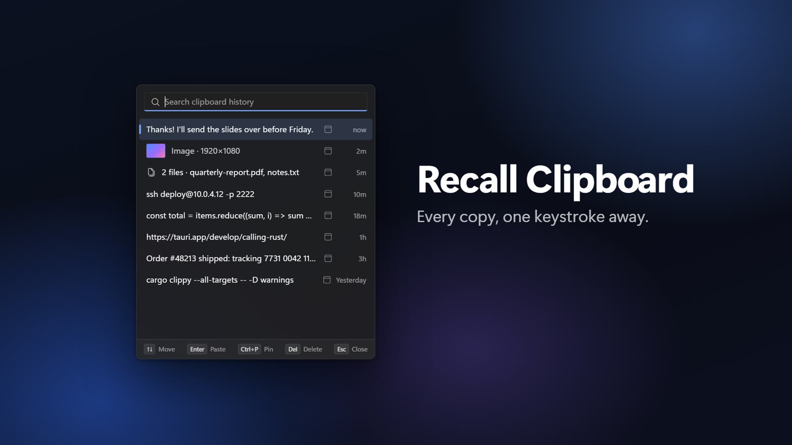

# Recall Clipboard

**Everything you copy, one keystroke away.** A fast, private clipboard history app for Windows 11.



| Quick paste (Ctrl+Shift+V) | History | Settings |
| --- | --- | --- |
|  |  |  |

## What it does

- **Remembers what you copy:** text, images, and files from File Explorer.
- **Pastes it back in one step.** Press **Ctrl+Shift+V**, type a few letters to find it, press **Enter**, and it's pasted where you were typing.
- **You pick what it saves.** Turn text, images, or files on or off during install or in Settings at any time.
- **No duplicates.** Copy the same thing twice and it just moves back to the top.
- **Pins.** Pin the things you use often. Pinned items stay at the top and are never deleted.
- **Shows where things came from.** Each item has the icon of the app you copied it from.
- **Full history window** with search, filters (text, images, files, pinned), and a preview.
- **Keeps private things private:**
  - Passwords copied from password managers are never saved.
  - Block any app you don't want recorded.
  - Pause recording from the tray icon.
  - Auto-delete old items, or clear everything at once.
- **Looks at home on Windows 11.** It follows your light/dark mode and accent color.
- **Lives in the tray** and can start with Windows.

### Keyboard shortcuts (in the popup)

| Key | What it does |
| --- | --- |
| Type | Search |
| ↑ / ↓ | Move up and down |
| Enter | Paste |
| Ctrl+P | Pin or unpin |
| Delete | Remove the item |
| Esc | Close |

## Install

1. Download `Recall Clipboard_x.y.z_x64-setup.exe` from the [latest release](../../releases/latest).
2. Run it and choose what you want to save.

Windows may show a "Windows protected your PC" warning because the app isn't signed. Click **More info → Run anyway**.

Works on Windows 10 too, with a slightly plainer look.

## Your privacy

Everything stays on your PC. The app never connects to the internet.

Your history is saved in `%APPDATA%\dev.recall.clipboard\`. To remove everything, uninstall the app and delete that folder.

It never saves a copy when:

- It comes from a password manager (like 1Password, Bitwarden, or KeePassXC). The app doesn't even look at it.
- It comes from an app you blocked.
- Recording is paused, or you turned that type off (text, images, or files).

## Build it yourself

You need:

- Windows 10 or 11
- [Rust](https://rustup.rs)
- Visual Studio Build Tools, with "Desktop development with C++"
- Node.js 22+ and [pnpm](https://pnpm.io)

```powershell
git clone https://github.com/cntr1er/recall-clipboard
cd recall-clipboard
pnpm install
pnpm tauri dev      # run the app while you work on it
pnpm tauri build    # make the installer (in src-tauri/target/release/bundle/nsis/)
```

Run the tests and checks:

```powershell
pnpm build
cd src-tauri
cargo fmt --check
cargo clippy --all-targets -- -D warnings
cargo test
```

## How it's built

- **Rust** (in `src-tauri/src`) does the work: it watches the clipboard, saves items to a small database, and pastes them back.
- **React** (in `src`) draws the windows: the popup, history, settings, and welcome screen.
- **Tauri** connects the two and makes the installer.

When you copy something:

1. Windows tells the app the clipboard changed. The app doesn't keep checking, so it uses no power while idle.
2. The app skips it if it's paused, the app is blocked, or it's a password.
3. It saves the item. Images are saved as files next to the database so the database stays small.
4. Old items are cleaned up and the windows refresh.

When you press Enter in the popup, the app puts the item on the clipboard, switches back to your previous window, and presses Ctrl+V for you.

## License

[MIT](LICENSE)
