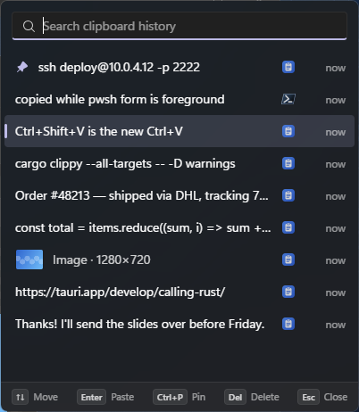
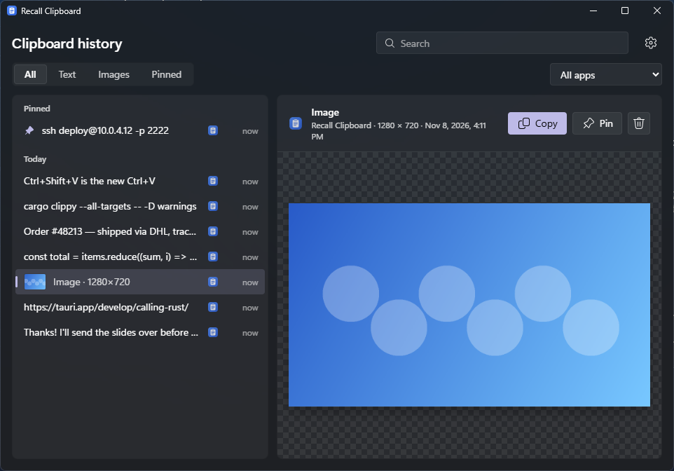
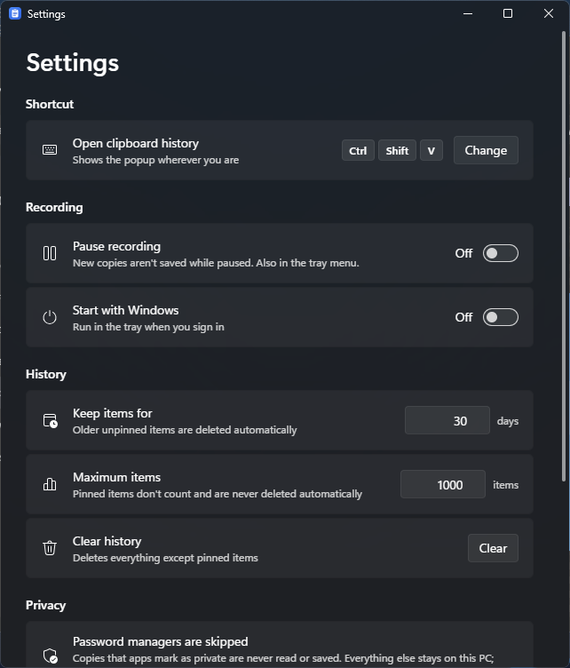

# Recall Clipboard

**Everything you copy, one keystroke away.** A fast, private clipboard history for Windows 11, built with Tauri and Rust.

<!-- TODO: replace with a short GIF of copy → Ctrl+Shift+V → paste -->


| History window | Settings |
| --- | --- |
|  |  |

## Features

- **Records text and images** in the background, using Windows clipboard notifications rather than polling.
- **No duplicates.** Copying something again moves it back to the top.
- **Ctrl+Shift+V popup** that opens at your cursor. Type to filter, pick with ↑/↓, press Enter, and the item is pasted into the app you were using.
- **Pins.** Pinned items stay at the top and are never deleted automatically.
- **Source apps.** Every item shows the icon of the app it was copied from, and the history can be filtered by app.
- **Full history window** with Text, Images and Pinned filters, date groups and a preview pane.
- **Privacy controls:**
  - Copies that password managers mark as private are skipped and never read.
  - An excluded-apps list.
  - Pause and resume from the tray.
  - Auto-delete after N days, plus a maximum history size.
  - Clear history (with a confirmation).
- **Native Windows 11 look:**
  - Mica backdrop and Segoe UI Variable.
  - Fluent icons.
  - Follows light and dark mode and your accent color.
- **Tray app** with Open, Pause/Resume, Settings and Quit, and an option to start with Windows.

### Keyboard (popup)

| Key | Action |
| --- | --- |
| Type | Filter |
| ↑ / ↓ | Move |
| Enter | Paste into the previous app |
| Ctrl+P | Pin / unpin |
| Delete | Remove the item |
| Esc | Close |

## Install

Download `Recall Clipboard_x.y.z_x64-setup.exe` from the [latest release](../../releases/latest) and run it. Windows 10 works too, but without Mica.

The installer isn't code-signed, so SmartScreen may warn you the first time. Choose *More info → Run anyway*.

## Privacy

All data stays on your PC. Recall Clipboard makes no network requests. History is stored in `%APPDATA%\dev.recall.clipboard\`:

| File | Contents |
| --- | --- |
| `history.db` | SQLite database of items and app names |
| `images\` | Copied images (PNG) and their thumbnails |
| `icons\` | Cached icons of source apps |
| `settings.json` | Your settings |

Recall Clipboard never records a copy when any of these is true:

- The clipboard carries `ExcludeClipboardContentFromMonitorProcessing`, `CanIncludeInClipboardHistory = 0` or `Clipboard Viewer Ignore`. Password managers such as 1Password, Bitwarden and KeePassXC set these markers. The content of such copies is never read.
- The copy came from an app on your excluded list.
- Recording is paused.

To remove everything, uninstall the app and delete that folder.

## Build from source

Prerequisites:

- Windows 10/11
- [Rust](https://rustup.rs) (stable)
- Visual Studio Build Tools with the "Desktop development with C++" workload
- Node.js 22+ and [pnpm](https://pnpm.io)
- WebView2 Runtime (already present on Windows 11)

```powershell
git clone https://github.com/<you>/recall-clipboard
cd recall-clipboard
pnpm install
pnpm tauri dev      # run with hot reload
pnpm tauri build    # installer → src-tauri/target/release/bundle/nsis/
```

Checks (the same ones CI runs):

```powershell
pnpm build                                          # typecheck + bundle frontend
cd src-tauri
cargo fmt --check
cargo clippy --all-targets -- -D warnings
cargo test
```

## Architecture

```
┌─────────────────────────── Rust (src-tauri/src) ───────────────────────────┐
│ clipboard.rs   message-only window + AddClipboardFormatListener; read/write│
│ privacy.rs     password-manager markers, excluded apps                     │
│ source_app.rs  foreground process → exe, friendly name, icon               │
│ images.rs      PNG/DIB decode, PNG + thumbnail on disk, content hash       │
│ storage.rs     SQLite: items (unique on kind+content), apps                │
│ hotkey.rs      global shortcut, popup at cursor, refocus + Ctrl+V          │
│ settings.rs    JSON settings · tray.rs · theme.rs (Mica, accent)           │
│ commands.rs    Tauri commands the UI calls; lib.rs wires it all together   │
└──────────────────────────────▲─────────────────────────────────────────────┘
                     invoke / events ("history-changed", "settings-changed")
┌──────────────────────────────┴───── React + TypeScript (src) ──────────────┐
│ views/Popup · views/History · views/Settings · views/Welcome               │
│ One bundle serves every window; the window label picks the view.           │
└────────────────────────────────────────────────────────────────────────────┘
```

How a copy flows through the app:

1. Windows sends `WM_CLIPBOARDUPDATE` to a hidden window.
2. Changes the app made itself are ignored, along with excluded apps and pauses.
3. The clipboard is opened. If a privacy marker is present, the copy is dropped before its content is read.
4. Text is upserted into SQLite. An image is decoded, hashed and saved as `images/<hash>.png` with a thumbnail, and its hash is upserted.
5. Retention cleanup runs, and the UI gets a `history-changed` event.

Design decisions:

- **Images live on disk, not in SQLite.** Screenshots are multi-megabyte. Keeping them out of the database keeps it small and fast, and the webview can load them straight from disk through Tauri's asset protocol. Each file is named by a hash of its pixels, so duplicates are free.
- **Notifications, not polling.** `AddClipboardFormatListener` costs nothing while idle and never misses a change.
- **Paste = clipboard + refocus + `SendInput`.** The popup remembers the foreground window when it opens. Enter writes the item, hides the popup, restores focus and sends Ctrl+V, releasing any modifiers that are still held.
- **No duplicates by construction.** `UNIQUE(kind, content)` plus an upsert means "copy again" just updates `copied_at`.

## License

[MIT](LICENSE)
